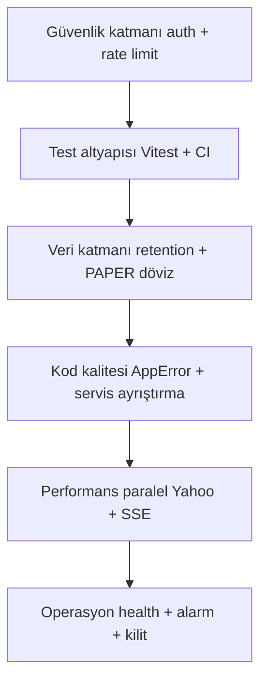

# BorsaRobot — İyileştirme Listesi (Mimari İnceleme Raporu)

> İnceleme kapsamı: [`docs/ARCHITECTURE.md`](docs/ARCHITECTURE.md), [`prisma/schema.prisma`](prisma/schema.prisma), [`src/server/services`](src/server/services), [`src/server/providers`](src/server/providers), [`src/app/api`](src/app/api), UI katmanı ve [`package.json`](package.json).
> Öncelik: 🔴 Kritik · 🟠 Yüksek · 🟡 Orta · 🟢 Düşük

---

## 1. Güvenlik — 🔴 Kritik

| # | Bulgu | Kanıt | Öneri |
|---|---|---|---|
| 1.1 | **Kimlik doğrulama ve yetkilendirme tamamen yok.** `/admin` paneli ve tüm `/api/admin/*` route'ları (mod değiştirme, API anahtarı kaydetme, canlı moda geçiş) internete açık herkese erişilebilir. | [`src/app/admin/page.tsx`](src/app/admin/page.tsx), [`src/app/api/admin/settings/route.ts`](src/app/api/admin/settings/route.ts) — projede `middleware.ts` yok, auth araması sıfır sonuç | NextAuth/Auth.js veya en azından `ADMIN_PASSWORD` + imzalı cookie ile [`middleware.ts`](src/middleware.ts) ekleyin; `/admin` ve `/api/admin/*` route'larını koruyun |
| 1.2 | **Emir ve canlı işlem endpoint'leri korumasız.** `POST /api/trading/order` ve `POST /api/trading/bulk-sell` LIVE modda gerçek para hareketi tetikler; tek curl isteği yeterli. | [`src/app/api/trading/order/route.ts`](src/app/api/trading/order/route.ts:25) | Auth + oturum sahipliği kontrolü; LIVE modda ikinci faktör (PIN/TOTP) |
| 1.3 | **Rate limiting yok.** LLM çağıran endpoint'ler (`/api/ai-decisions/ask`, `/api/analysis`, `/api/auto-trade/run`, `/api/admin/test-ai`) sınırsız → API maliyet saldırısı ve provider kotası tükenmesi riski. | [`src/app/api/ai-decisions/ask/route.ts`](src/app/api/ai-decisions/ask/route.ts), [`src/app/api/auto-trade/run/route.ts`](src/app/api/auto-trade/run/route.ts) | IP/oturum bazlı token-bucket middleware; LLM çağrılarında günlük çağrı bütçesi |
| 1.4 | **API anahtarları veri tabanında düz metin.** Tüm LLM anahtarları `AdminSettings` tablosunda şifresiz saklanıyor; DB dosyası sızarsa tüm anahtarlar sızar. | [`src/server/services/settings-service.ts`](src/server/services/settings-service.ts:99) | AES-256-GCM ile şifreleme; master key `.env`'de (`SETTINGS_ENCRYPTION_KEY`), DB'de yalnızca ciphertext |
| 1.5 | **`prisma/dev.db` ve `.env` çalışma dizininde.** `.gitignore` kapsamı doğrulanmalı; `tsconfig.tsbuildinfo` da repoya girmiş görünüyor. | kök dizin listesi | `.gitignore`'a `*.tsbuildinfo`, `prisma/dev.db`, `*.db-journal` ekleyin; geçmişe sızdıysa anahtarları rotate edin |

## 2. Test ve CI Altyapısı — 🟠 Yüksek

| # | Bulgu | Öneri |
|---|---|---|
| 2.1 | **Gerçek birim testi yok.** [`scripts/verify-*.ts`](scripts) script'leri uçtan uca doğrulama; iş mantığı hataları (örn. risk kuralları, Decimal hesapları) granüler yakalanamıyor. | Vitest ekleyin; öncelikle [`trading-service.ts`](src/server/services/trading-service.ts) risk kuralları, [`paper-trading-provider.ts`](src/server/providers/paper-trading-provider.ts) bakiye/pozisyon matematiği ve [`llm-response-parser.ts`](src/server/services/llm-response-parser.ts) için birim testler |
| 2.2 | **CI pipeline yok.** `verify:all` 14 script'i sıralı koşar; typecheck dahil değil. | GitHub Actions: `typecheck` + `verify:all` (SQLite, `AUTO_TRADE_SCHEDULER_DISABLED=1`); PR gate olarak zorunlu kılın |
| 2.3 | **Lint/format araçları yok.** `package.json`'da `lint` script'i bile yok; ESLint, Prettier, husky yok. | `eslint-config-next` + Prettier + pre-commit hook; [`next.config.ts`](next.config.ts) yanına `eslint.config.mjs` |

## 3. Veri Katmanı — 🟠 Yüksek

| # | Bulgu | Kanıt | Öneri |
|---|---|---|---|
| 3.1 | **Log tabloları sınırsız büyüyor.** `ApiCallLog`, `AiAnalysisLog`, `AiDecisionLog`, `JobRun` temizlenmiyor; SQLite dosyası haftalar içinde onlarca GB'a ulaşabilir, sorgular yavaşlar. | [`src/server/services/api-log-service.ts`](src/server/services/api-log-service.ts:35) | Retention politikası: scheduler'a günlük temizlik job'ı (örn. 30 gün); `ApiCallLog` için aylık arşiv |
| 3.2 | **Tek kullanıcılı model çok kullanıcılıya kilitli.** `Portfolio` tablosunda `@@unique([stockId])` var — kullanıcı boyutu yok; `Account` seçimi `findFirst({ accountType: "PAPER" })` ile belirsiz. | [`prisma/schema.prisma`](prisma/schema.prisma:139), [`src/server/services/portfolio-service.ts`](src/server/services/portfolio-service.ts:93) | Şemaya `User` + `userId` FK'ları ekleyin (en azından hazırlık: `Account.ownerId`, `Portfolio.accountId`); `@@unique([accountId, stockId])` |
| 3.3 | **PAPER döviz emirleri çalışmıyor.** `PaperTradingProvider`, `currency: request.currency` ile hesap arıyor; seed yalnızca TRY hesabı oluşturuyor → PAPER modda USD/EUR emri `ACCOUNT_NOT_FOUND` ile reddedilir. | [`src/server/providers/paper-trading-provider.ts`](src/server/providers/paper-trading-provider.ts:81) | PAPER modda döviz emirlerini TRY karşılığına çevirip TRY hesabından işleyin veya seed'e döviz hesapları ekleyin |
| 3.4 | **PostgreSQL geçişi planlı ama yapılmamış.** Mimari doküman ADR-5'te PostgreSQL diyor; üretim hâlâ SQLite. | [`docs/ARCHITECTURE.md`](docs/ARCHITECTURE.md) | Üretim dağıtımı öncesi Postgres migration'ı + `Decimal` davranış farklarının (SQLite TEXT saklama) test edilmesi |
| 3.5 | **Migration disiplini zayıf.** Tek migration var; `db:push` kullanımı şema sürüklenmesine yol açar. | [`prisma/migrations`](prisma/migrations) | `db:push` yerine `migrate dev/deploy` akışına geçin; CI'da `migrate deploy` doğrulaması |

## 4. Mimari ve Kod Kalitesi — 🟠 Yüksek

| # | Bulgu | Kanıt | Öneri |
|---|---|---|---|
| 4.1 | **Ölü/yanıltıcı factory fonksiyonu.** [`getTradingProvider()`](src/server/providers/provider-factory.ts:47) komisyonu hardcoded `new Prisma.Decimal(0.1)` ile kuruyor; admin'in komisyon ayarını yok sayar. Yalnızca [`resolveTradingProvider()`](src/server/providers/provider-factory.ts:61) doğru çalışıyor. | [`src/server/providers/provider-factory.ts`](src/server/providers/provider-factory.ts:51) | Fonksiyonu silin veya async yapıp `commissionRate`'i settings'ten okuyun; çağıranları `resolveTradingProvider`'a yönlendirin |
| 4.2 | **Servis dosyaları şişkin.** `trading-service.ts` 609 satır (risk kuralları dahil), `auto-trade-service.ts` 915 satır (SL/TP + AI sinyal + karar kaydı tek dosyada). Mimari doküman `RiskService`'i ayrı planlamış. | [`src/server/services/trading-service.ts`](src/server/services/trading-service.ts:370), [`src/server/services/auto-trade-service.ts`](src/server/services/auto-trade-service.ts) | `risk-service.ts` (assertRiskRules) ve `signal-processor.ts` ayrıştırın; dosya başına tek sorumluluk |
| 4.3 | **Hata sınıfları tekrarlanıyor.** `TradingError`, `PriceServiceError`, `NewsServiceError`, `AnalysisServiceError`, `Bist100SyncError`... hepsi aynı `message + code + httpStatus` desenini kopyalıyor. | [`src/server/services/price-service.ts`](src/server/services/price-service.ts:26) | Ortak `AppError extends Error { code, httpStatus }` taban sınıfı; API katmanında tek `instanceof AppError` eşlemesi |
| 4.4 | **Ayar güncelleme kodu tekrarlı.** [`admin/settings/route.ts`](src/app/api/admin/settings/route.ts:92) 20+ satır `if (update.x !== undefined) data.x = update.x`; [`settings-service.ts`](src/server/services/settings-service.ts:16) 40+ alanı manuel maskeliyor. | her iki dosya | Alan listesinden türeyen map tabanlı serileştirme/güncelleme; provider anahtarlarını `Record<Provider, {key, model}>` yapısına indirin |
| 4.5 | **Döviz listesi iki yerde tekrar.** `FX_ORDER_CURRENCIES` ([`trading-service.ts`](src/server/services/trading-service.ts:97)) ve `FX_CURRENCIES` ([`live-trading-provider.ts`](src/server/providers/live-trading-provider.ts:53)) aynı listeyi tutuyor. | iki dosya | [`src/lib/constants.ts`](src/lib/constants.ts)'e tek `SUPPORTED_FX_CURRENCIES` sabiti; tipi buradan türetin |
| 4.6 | **console.log tabanlı loglama.** Tüm servisler `console.log/warn/error` kullanıyor; seviye, yapı ve korelasyon (jobRunId) yok. | [`src/server/services/scheduler.ts`](src/server/services/scheduler.ts:131) | pino + request-id/jobRunId bağlamı; üretimde JSON log, geliştirmede pretty |
| 4.7 | **`dec()` helper'ı savunmacı değil.** [`dec()`](src/server/services/trading-service.ts:92) `value ? ... : null` kullanıyor; `Decimal(0)` obje olduğu için bug yok ama niyet belirsiz. | tek satır | `value != null` açık kontrolüne çevirin |

## 5. Performans — 🟡 Orta

| # | Bulgu | Kanıt | Öneri |
|---|---|---|---|
| 5.1 | **Grafik sorguları tüm kayıtları belleğe alıyor.** `getChartCandles` 1Y/5Y aralığında binlerce `PriceHistory` satırını JS'te bucket'lıyor. | [`src/server/services/price-service.ts`](src/server/services/price-service.ts:85) | SQL tarafında `groupBy` + `date_trunc` benzeri aggregation (Postgres'e geçişte `dateBin`); veya bucket'lanmış özet tablo |
| 5.2 | **Yahoo tick'i sıralı ve yavaş.** İstekler arası 200 ms gecikme + sıralı fetch → 100 sembollük tick 20+ saniye sürer; SL/TP kontrolü bu kadar gecikir. | [`src/server/providers/yahoo-finance-client.ts`](src/server/providers/yahoo-finance-client.ts:43) | Concurrency limitli paralel fetch (p-limit, 4-6 eşzamanlı); v7 toplu quote'u crumb ile aktif etme |
| 5.3 | **Client polling veri trafiği şişiriyor.** İzleme listesi, AI kararları ve hisse detayı `setInterval` + tam sayfa fetch ile yenileniyor. | [`src/components/watchlist/WatchlistClient.tsx`](src/components/watchlist/WatchlistClient.tsx:236), [`src/components/ai-decisions/DecisionsClient.tsx`](src/components/ai-decisions/DecisionsClient.tsx:343) | SSE (`ReadableStream`) veya WebSocket ile push; en azından delta-only yanıt |
| 5.4 | **Ana sayfa her istekte tam DB taraması.** `force-dynamic` + `getWatchlistPrices` her ziyarette tüm hesaplamayı yeniden yapıyor. | [`src/app/page.tsx`](src/app/page.tsx:18) | `revalidate = 10` + fiyat verisini ISR/cache; statik kartlar için `unstable_cache` |
| 5.5 | **Haber ekleme döngüsü tek tek INSERT.** `scanNewsForStock` makale başına ayrı `create` çağrısı yapıyor. | [`src/server/services/news-service.ts`](src/server/services/news-service.ts:68) | Önce mevcut `urlHash` setini tek sorguda çekin, sonra `createMany` (SQLite'ta skipDuplicates yok; set karşılaştırması yeterli) |

## 6. Gözlemlenebilirlik ve Operasyon — 🟡 Orta

| # | Bulgu | Öneri |
|---|---|---|
| 6.1 | **Sağlık endpoint'i yok.** `/api/health` yok; DB, scheduler, Yahoo, banka bağlantı durumu tek yerden görülemiyor. | `GET /api/health` → DB ping + `isSchedulerRunning()` + son JobRun durumu; uptime izlemesi buna bağlanır |
| 6.2 | **Çok instance'da scheduler çakışması.** `setInterval` tabanlı scheduler tek process varsayıyor; iki instance (PM2 cluster, container replika) aynı anda tick atarsa farklı `cycleId`'lerle çift emir üretilir. | [`src/server/services/scheduler.ts`](src/server/services/scheduler.ts:196) | DB tabanlı kilit (`JobRun` üzerinde unique `jobType+startedMinute` veya `SELECT ... FOR UPDATE`); veya dış cron'a taşıma (ADR-10'daki Vercel Cron planı) |
| 6.3 | **Uyarı/alarm kanalı yok.** Döngü FAILED olsa bile bildirim yok; kullanıcı loglara bakmak zorunda. | E-posta/Telegram webhook ile kritik olay alarmı (SL tetiklendi, banka hatası, LLM kotası) |
| 6.4 | **Günlük bütçe saati sunucu saatine bağlı.** `dayStart.setHours(0,0,0,0)` sunucu TZ'sine göre; farklı TZ'de dağıtılırsa bütçe penceresi kayar. | [`src/server/services/trading-service.ts`](src/server/services/trading-service.ts:405) | Europe/Istanbul TZ'sini açıkça sabitleyin (`Intl` veya `TZ` env) |

## 7. İş Mantığı Tutarlılığı — 🟡 Orta

| # | Bulgu | Kanıt | Öneri |
|---|---|---|---|
| 7.1 | **Confidence ölçeği tutarsız.** `AiAnalysisLog.confidence` 0–1 (Decimal), `AiDecisionLog.confidence` 0–100 (Int) — iki akışta aynı kavram farklı ölçekte. | [`prisma/schema.prisma`](prisma/schema.prisma:247), [`prisma/schema.prisma`](prisma/schema.prisma:287) | Tek ölçeğe indirin (0–100 önerilir) ve dönüşümü tek helper'da toplayın |
| 7.2 | **SL/TP kontrolü tick'e bağımlı.** Stop-loss yalnızca otomatik döngü aralığında (min 10 sn, varsayılan 60 sn) değerlendiriliyor; hızlı düşüşte zarar büyür. | [`src/server/services/auto-trade-service.ts`](src/server/services/auto-trade-service.ts:344) | Fiyat tick'i sonrası anında SL/TP taraması (event-driven); veya tick route'unda pozisyon guard'ı |
| 7.3 | **LIVE modda hisse emri deneyimi.** `LIVE_STOCK_NOT_SUPPORTED` reddi doğru ama UI'da LIVE modda hisse formu hâlâ aktif görünüyor. | [`src/components/trading/OrderForm.tsx`](src/components/trading/OrderForm.tsx) | LIVE modda STOCK sekmesini devre dışı bırakıp açıklama gösterin |

## 8. UI/UX — 🟢 Düşük

| # | Bulgu | Öneri |
|---|---|---|
| 8.1 | **Tema hardcoded.** [`layout.tsx`](src/app/layout.tsx:40) `bg-[#0b0f17]` sabit renk; açık tema yok. | Tailwind CSS değişkenleri + `next-themes` ile tema desteği |
| 8.2 | **Mobil navigasyon taşması.** 6 nav öğesi + mod kontrolleri küçük ekranda sıkışıyor. | `md:` altında hamburger menü / alt tab bar |
| 8.3 | **Yükleme ve hata durumları sayfa bazlı dağınık.** Her client kendi skeleton/error UI'ını yazıyor. | Ortak `Skeleton`, `ErrorState`, `EmptyState` bileşenleri ([`src/components/admin/shared.tsx`](src/components/admin/shared.tsx) deseni genelleştirilir) |
| 8.4 | **`loading.tsx` / `error.tsx` yok.** Route segmentlerinde bekleyen hiçbir dosya yok; sunucu hatası çıplak 500 sayfası üretir. | Her ana route'a `loading.tsx` + kök `error.tsx` + `not-found.tsx` |

## 9. Dokümantasyon — 🟢 Düşük

| # | Bulgu | Öneri |
|---|---|---|
| 9.1 | **ARCHITECTURE.md Faz 0 tarihli.** 1041 satırlık doküman ilk tasarımı anlatıyor; Faz 6-7 sonrası gerçek durumla (SQLite, NVIDIA provider, BIST100 sync) senkron değil. | "Mevcut Durum" bölümü ekleyin; ADR tablosuna uygulanan/iptal edilen kararları işaretleyin |
| 9.2 | **README PostgreSQL diyor, gerçeklik SQLite.** | Teknoloji tablosunu güncelleyin; Postgres geçiş planını "Yol Haritası" başlığına taşıyın |

---

## Önerilen Uygulama Sırası

1. **Faz A — Güvenlik**: auth middleware, admin route koruması, rate limit, anahtar şifreleme (1.1–1.5)
2. **Faz B — Test/CI**: Vitest kurulumu, kritik birim testler, GitHub Actions, ESLint (2.1–2.3)
3. **Faz C — Veri**: log retention, PAPER döviz düzeltmesi, migration disiplini (3.1–3.5)
4. **Faz D — Kod kalitesi**: ölü factory temizliği, AppError, servis ayrıştırma (4.1–4.7)
5. **Faz E — Performans**: paralel Yahoo, SSE, cache (5.1–5.5)
6. **Faz F — Operasyon**: health endpoint, scheduler kilidi, alarm (6.1–6.4)
